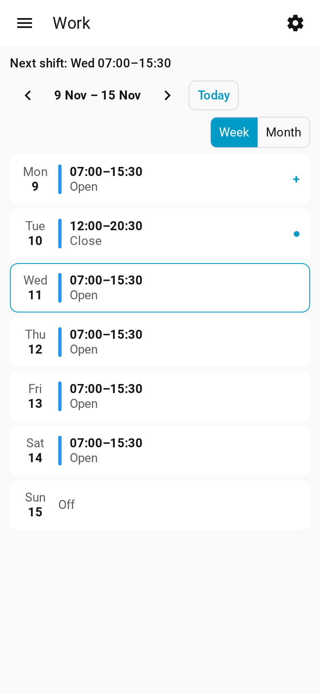
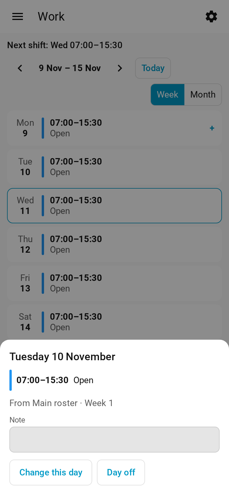
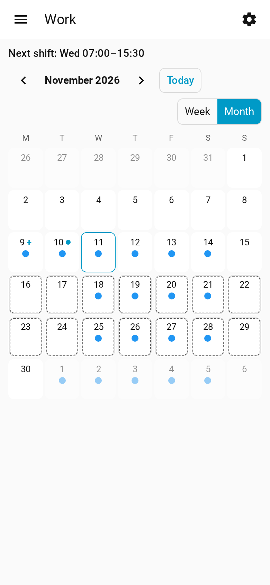
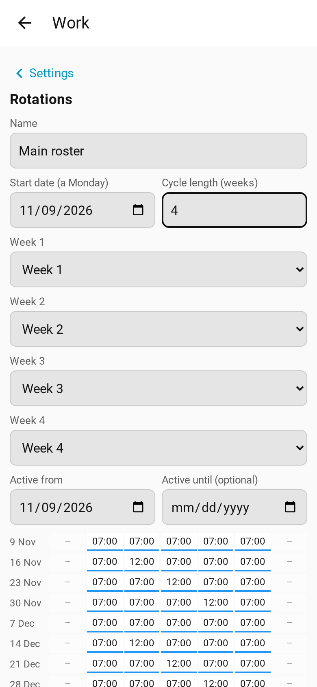

# Roster Planner

A Home Assistant integration that models a rotating work roster as rules and exposes it as a normal calendar. Define your shifts and how they repeat once, and every future week follows. Temporary changes revert on their own.

Nothing is copied into another calendar: each day's shift is computed on demand, so changing a rule instantly changes every future week. The result is a standard calendar entity, so the Calendar sidebar, automations and dashboards all work with it.

<p>
  
  
  
  
</p>

## Install

Requires Home Assistant 2026.10 or newer.

1. In HACS, open the menu and choose **Custom repositories**.
2. Add `https://github.com/muazamkamal/ha-roster-planner` as an **Integration**.
3. Download **Roster Planner** and restart Home Assistant.
4. Go to **Settings → Devices & services → Add integration → Roster Planner**.

Each roster is one integration entry, so add a second entry for a second person. The **Roster** item appears in the sidebar.

## Setting up a roster

Open **Roster**, tap the gear, then work down the list:

1. **Shift types**: the shifts you work, such as "Open 07:00–15:30". An end time at or before the start means the shift ends the next day.
2. **Week patterns**: a Monday-to-Sunday template. Use **Duplicate** for weeks that are nearly the same.
3. **Rotations**: a cycle of 1–12 weeks, one pattern per week, counted from a Monday. **Quick add: recurring shift** handles cases like "every 2 weeks on Monday".
4. **Variations**: a date range that temporarily replaces the rotation, either with another pattern or by editing specific weekdays. The rotation resumes by itself afterwards.

For one-off changes, tap a day on the main screen.

Each date is resolved in this order, and the first answer wins: one-off exception, then variation, then rotations by priority. An empty slot or day off in a rotation falls through to the next rotation, so a "Monday every other week" rotation can sit alongside a main Tuesday-to-Saturday one.

## Who can edit

Each roster has an optional **owner**, set when adding it or later under the integration's **Configure** option.

| User | Can do |
| --- | --- |
| Admin | Edit every roster |
| Owner | Edit their own roster |
| Anyone else | View only |

Automations can always use the services below.

## Entities and services

| Entity | Description |
| --- | --- |
| `calendar.<name>` | One event per working day. `on` during a shift. |
| `sensor.<name>_next_shift_start` | When the next shift starts. |
| `sensor.<name>_next_shift_end` | When the current or next shift ends. |

The calendar can also be edited from the stock Calendar screen or `calendar.create_event`. Those edits are saved as one-off exceptions. Repeating and all-day events are rejected, and a shift must be shorter than 24 hours.

`roster_planner.set_exception` takes a `date` and exactly one of `shift_type`, `start` and `end`, or `off`. `roster_planner.clear_exception` takes a `date`.

```yaml
action: roster_planner.set_exception
target:
  entity_id: calendar.work
data:
  date: "2026-12-24"
  off: true
  note: Christmas Eve
```

## Development

The devcontainer installs everything. Then:

```sh
scripts/develop                  # Home Assistant on port 8123
cd frontend && npm run watch     # rebuild the panel on save
```

Restart Home Assistant after Python changes. The panel only needs a browser refresh.

```sh
.venv/bin/pytest
.venv/bin/ruff check custom_components tests
.venv/bin/mypy
cd frontend && npm run lint && npm test && npm run build
```

The built panel is committed so HACS users need no Node toolchain, and CI fails if it is stale. Run `npm run build` before committing frontend changes.

### Design notes

Choices made where the design left room, or where Home Assistant required a change:

- Schemas use `probatio`, which replaced `voluptuous` in Home Assistant core. Tested on 2026.10.4; earlier releases may not include it.
- Websocket commands use `item_id`, because `id` is reserved for the message id.
- The base `CalendarEntity` schedules its own state changes at each event's start and end. The integration adds only a daily refresh, for shifts beyond the 60-day lookahead.
- `roster_planner/resolve` returns every date, including days off, so the panel can offer "Reset to roster" on a cancelled day.
- Event titles have a configurable prefix, empty by default. Past exceptions are kept and collapsed in the UI.

### Manual test checklist

- [ ] Phone browser: week and month views, swipe between weeks, day sheet
- [ ] HA Companion app: the same, plus the sidebar menu button and the back gesture
- [ ] Desktop browser: month view shows times instead of dots
- [ ] Light and dark themes, and a custom theme
- [ ] Backup: export then import, including in the Companion app
- [ ] A non-admin, non-owner account sees a read-only panel
